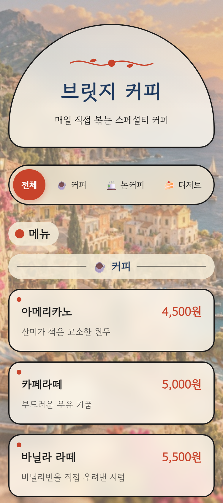

# 브릿지 커피 디지털 메뉴판

손님이 테이블의 QR코드를 찍으면 휴대폰으로 보게 되는 **디지털 메뉴판 웹페이지**예요.
설치나 서버 없이, `index.html`을 브라우저로 열기만 하면 바로 보여요.

<p align="center">
  
</p>

## 주요 기능

- **카테고리 버튼**: 전체 / ☕ 커피 / 🍵 논커피 / 🍰 디저트. 누르면 그 메뉴만 보여요. 처음에는 '전체'가 선택돼 있어요. 화면을 내려도 버튼 줄이 위에 따라다녀요.
- **⭐ 시그니처**: 사장님이 고른 메뉴에 딱지가 붙고, 카드가 조금 더 눈에 띄어요. (지금: 아인슈페너, 흑임자 라떼)
- **오늘 품절**: 품절 메뉴는 흐리게 보이고, 가격에 줄이 그어지고, '오늘 품절' 딱지가 떠요. (지금: 당근케이크)
- **📞 전화 걸기**: 누르면 바로 가게로 전화가 걸려요.
- **매장 안내**: 영업시간, 위치, 인스타그램 링크
- **▲ 위로 버튼**: 화면을 많이 내리면 오른쪽 아래에 나타나요.
- **휴대폰 화면에 맞춤**: 폭 390px 기준이에요. 폭이 좁은 휴대폰(360px)과 가로 화면에서도 깨지지 않게 점검했어요.

## 디자인

- **색깔**: 일본 옛 목판화(우키요에) 색이에요. 한지 종이색, 먹색, 쪽빛 남색, 주홍색, 겨자색을 써요.
- **카드**: 뒤가 살짝 비치는 유리 같은 카드(글래스모피즘)예요. 모서리는 둥글고, 그림자는 부드럽고, 먹색 테두리를 둘렀어요.
- **배경**: 바닷가 마을 사진(`자료/배경사진.png`)을 50% 진하기로 깔았어요.
- **글꼴**: 고운 돋움이에요. 인터넷이 없을 때는 맑은 고딕으로 보여요.

## 보는 방법

1. 이 저장소를 내려받아요.
2. `index.html`을 두 번 누르면 브라우저에서 열려요.
3. 손님이 QR로 보게 하려면 메뉴판을 인터넷 주소로 올려야 해요. (예: GitHub Pages 같은 무료 호스팅)
   이때 **`자료` 폴더도 같이** 올려야 배경 사진이 보여요.

## 고치는 방법

메모장 같은 프로그램으로 `index.html`을 열면, 고칠 곳마다 ✏️ 표시와 한국어 안내가 달려 있어요.
따옴표(`" "`) 안의 글자나 숫자만 바꾸고, 따옴표와 쉼표(`,`)는 지우지 마세요.
고친 뒤 저장하고 브라우저에서 **새로 고침(F5)** 을 누르면 바로 바뀌어요.

> 💡 고치기 전에 `index.html`을 복사해서 백업해 두면 안심이에요.

### ✏️ ① 가게 정보

가게 이름, 한 줄 소개, 영업시간, 전화번호, 위치, 인스타 아이디를 바꿀 수 있어요.

- 영업시간은 `·`로 나누면 화면에서 한 줄씩 나뉘어 보여요.
- 인스타는 `@` 뒤의 아이디만 쓰세요. 비워 두면(`""`) 화면에서 사라져요.

### ✏️ ② 메뉴

메뉴 한 줄은 이렇게 생겼어요.

```js
{ 묶음: "디저트", 이름: "스콘", 가격: "4,000원", 설명: "겉은 바삭 속은 촉촉, 잼과 함께", 추천: 0, 품절: 0 },
```

| 하고 싶은 일 | 방법 |
|---|---|
| 이름·가격·설명 바꾸기 | 따옴표 안의 글자만 바꿔요. 가격은 `"4,500원"`처럼 '원'까지 써요. |
| 메뉴 추가 | 같은 묶음의 한 줄을 통째로 복사해서 바로 아래에 붙이고, 글자를 바꿔요. |
| 메뉴 삭제 | 그 줄을 통째로 지워요. |
| ⭐ 시그니처 켜기 / 끄기 | `추천: 0` ↔ `추천: 1` (숫자 한 글자) |
| 오늘 품절 켜기 / 끄기 | `품절: 0` ↔ `품절: 1` (숫자 한 글자) |
| 새 묶음(카테고리) 만들기 | `묶음:`에 새 이름(예: `"빙수"`)을 쓰면 버튼이 저절로 생겨요. 버튼 앞 그림은 바로 아래 '묶음그림' 칸에 한 줄 넣어요. |

딱지 글자('⭐ 시그니처', '오늘 품절')도 메뉴 목록 바로 아래 ✏️ 칸에서 바꿀 수 있어요.

### ✏️ ③ 색깔과 진하기

`<style>` 맨 위 🎨 칸에서 숫자를 바꿔요.

| 줄 | 하는 일 |
|---|---|
| `--한지`, `--먹`, `--쪽빛`, `--주홍`, `--겨자` | 전체 색깔 (`#` 뒤의 색 번호) |
| `--사진진하기: 0.5;` | 배경 사진 진하기 (0 = 안 보임, 1 = 사진 그대로) |
| `--카드유리` 맨 끝 숫자 | 카드가 비치는 정도 (숫자가 클수록 덜 비치고 글씨가 또렷해요) |
| `--목판화진하기: 0;` | 숨겨 둔 파도·산·해 그림. `0.9`로 바꾸면 다시 보여요. |
| `--숲노을배경: none;` | 숨겨 둔 예전 숲·노을 배경. `block`으로 바꾸면 다시 보여요. |

### 배경 사진 바꾸기

`자료` 폴더에 새 사진을 **`배경사진.png`** 라는 같은 이름으로 넣으면 돼요.

## 테이블용 QR 코드 만들기 (`qr.html`)

`qr.html`은 메뉴판 주소를 QR 코드로 만들어 주는 **사장님용 도구**예요. 손님에게 보이는 화면이 아니에요.

1. `qr.html`을 두 번 눌러서 브라우저로 열어요.
2. **메뉴판 주소** 칸에 손님이 볼 메뉴판의 인터넷 주소를 붙여넣고 **QR 만들기**를 눌러요. 주소 앞에 `https://`를 빼먹어도 알아서 붙여 줘요.
3. QR **위**에 들어갈 가게 이름, **아래**에 들어갈 안내 문구(처음에는 "메뉴판 보기")는 입력 칸에서 바꿀 수 있어요.
4. **이미지로 저장**을 누르면 `메뉴판-QR.png` 파일로 내려받아요. **인쇄하기**를 누르면 QR 카드만 A4 한 장에 크게 나와요. (카드 가로 약 18cm, QR 약 15cm)

**인터넷이 없어도 되나요?**

- ✅ QR 만들기, 저장, 인쇄는 **인터넷 없이도 돼요.** QR을 만드는 프로그램([qrcode-generator](https://github.com/kazuhikoarase/qrcode-generator), MIT 라이선스)이 파일 안에 들어 있어요.
- ⚠️ 손님이 QR을 찍고 메뉴판을 보려면, **메뉴판(`index.html`)이 인터넷 주소로 올라가 있어야** 해요. (예: GitHub Pages를 켜면 `https://alswjd007123-lgtm.github.io/Menu-bord/` 같은 주소가 생겨요)
- 글꼴(고운 돋움)만 인터넷이 있을 때 불러와요. 없으면 맑은 고딕으로 나와요.

> 인쇄하기 전에 휴대폰 카메라로 QR이 잘 찍히는지 꼭 한 번 확인하세요.

## 파일 구성

```
메뉴판/
├─ index.html        메뉴판 전체 (HTML + CSS + JavaScript)
├─ qr.html           테이블용 QR 코드 만들기 도구 (인터넷 없이도 동작)
├─ README.md         이 문서
├─ CLAUDE.md         이 프로젝트를 AI와 함께 만들 때 지키는 약속
└─ 자료/
   ├─ 배경사진.png    메뉴판 배경 사진
   ├─ 미리보기.png    이 문서에 나오는 화면 사진
   └─ 기획시트.png    가게 정보와 메뉴를 정리한 기획 시트
```

## 가게 정보

- 가게: 브릿지 커피 (광주 북구 비엔날레)
- 소개: 매일 직접 볶는 스페셜티 커피
- 영업시간: 평일 08:00 - 21:00 / 주말 10:00 - 20:00 / 목요일 휴무
- 전화: 062-000-0000 (예시 번호예요. 실제 번호로 바꿔서 쓰세요)
- 인스타그램: [@bridge_coffee](https://www.instagram.com/bridge_coffee/)
